# mail-auth-lint

Email spoofing is solved on paper: SPF, DKIM and DMARC. In practice most domains have a record that is wrong in a small, silent way: two SPF records, a `+all`, DMARC stuck on `p=none` for three years, a 1024-bit DKIM key. mail-auth-lint reads your DNS records and says which.



**Live demo:** https://jvch0512.github.io/mail-auth-lint/ (a report on a synthetic zone export for `example.test` domains)

Haskell, `base` only. The parsing and every rule are pure functions, which is why the test suite can be this thorough.

## Use

```bash
make build
./mail-auth-lint zone.txt
./mail-auth-lint zone.txt --html > report.html
./mail-auth-lint zone.txt --fail-below 75      # exit 1 if any domain scores under 75
```

Input is a plain zone-style export, one record per line: `name [ttl] [IN] TXT|MX value`. Multi-chunk quoted TXT values are joined, comments start with `;` or `#`. A `dig` or provider export easily fits. Each domain gets a grade A to F and a score out of 100.

| Rule | Severity | What it catches |
|---|---|---|
| MA002 | critical | two SPF records or two DMARC records (SPF stops working, DMARC is ignored) |
| MA003 | critical to medium | SPF ending in `+all`, `?all`, `~all`, or with no `all` |
| MA007 | critical to medium | DKIM keys that look like 512-bit or 1024-bit RSA, and testing mode `t=y` |
| MA001 | high | no SPF record |
| MA004 | high, medium | more than 10 SPF DNS lookups, or use of `ptr` |
| MA005 | high | no DMARC record |
| MA008 | high | DMARC record that does not start with `v=DMARC1` or has no valid `p=` |
| MA006 | medium | DMARC `p=none`, no `rua=`, `pct` below 100 |

See [examples/zone.txt](examples/zone.txt) and [docs/sample-output.txt](docs/sample-output.txt).

## Limits

- It reads an export, it does not query DNS. Nested SPF includes are not expanded, so the lookup count is a lower bound.
- DKIM key size is estimated from the base64 length of the public key. It is accurate for RSA.
- Domains that send no mail should publish `v=spf1 -all` and a DMARC reject policy. The tool reports the missing records but does not know which domains are meant to be parked.
- MTA-STS, TLS-RPT, BIMI and ARC are out of scope.

## Where it fits

Email security reviews, M&A due diligence on a domain portfolio, phishing-resilience assessments, and a fixed-price "email authentication check" for small companies. Pairs well with its sibling [external-posture](https://github.com/jvch0512/external-posture).

## Tests

```bash
make test    # 44 checks
```

MIT.
